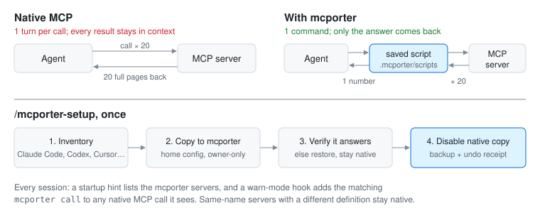
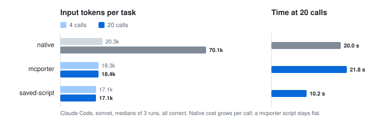

<div align="center">


# Srulik Toolkit

[](LICENSE)
[](https://claude.ai/code)
[](https://github.com/openai/codex)
[](https://cursor.com)
[](https://github.com/tzachbon/srulik-toolkit/actions/workflows/validate.yml)
[](CONTRIBUTING.md)

**Twenty-six focused skills for understanding, planning, and shipping software with Claude Code, Codex, and Cursor.**

[Install](#install) · [Skills](#skills) · [mcporter](#mcporter-plugin) · [Contributing](#contributing) · [Reference](docs/reference.md)

</div>

Each skill works on its own. Install the plugin, then name a skill or describe
the task in plain language. `handoff` runs only when named.

## Install

Restart your agent after installing. Updates, uninstall, and hook details are in
the [reference](docs/reference.md).

### Claude Code

```text
/plugin marketplace add tzachbon/srulik-toolkit
/plugin install srulik-toolkit@srulik-toolkit
```

### Codex

```bash
codex plugin marketplace add tzachbon/srulik-toolkit --ref main
codex plugin add srulik-toolkit@srulik-toolkit
```

Then open `/hooks` and trust the plugin hook.

### Cursor

```bash
git clone https://github.com/tzachbon/srulik-toolkit.git
cp -R srulik-toolkit/plugins/srulik-toolkit ~/.cursor/plugins/local/srulik-toolkit
```

Copy the folder instead of symlinking it; Cursor skips outside symlinks. The
startup hook runs from `hooks/hooks-cursor.json`.

### Oh My Pi

Add the installed plugin directory to a profile's `extensions` list. Skills load
through `skill://<name>`; lifecycle hooks do not run.

## Skills

Codex uses `$skill-name`; Claude Code also exposes skills as slash commands.

```text
$create-plan Add offline support to this app
$review-pro-max Review the changes on my current branch
$execute-task-end-to-end Add offline support and drive its PR to MERGE READY
```

| Skill | Use it to |
| --- | --- |
| [`can-you-help`](plugins/srulik-toolkit/skills/can-you-help/SKILL.md) | Figure out what a supplied request needs. |
| [`to-project`](plugins/srulik-toolkit/skills/to-project/SKILL.md) | Turn an idea or folder into a project. |
| [`create-plan`](plugins/srulik-toolkit/skills/create-plan/SKILL.md) | Research and write an execution-ready plan. |
| [`implement-plan`](plugins/srulik-toolkit/skills/implement-plan/SKILL.md) | Execute an approved plan with review loops. |
| [`skill-creator`](plugins/srulik-toolkit/skills/skill-creator/SKILL.md) | Create, edit, and evaluate a skill. |
| [`create-pr`](plugins/srulik-toolkit/skills/create-pr/SKILL.md) | Open a PR with review evidence. |
| [`execute-task-end-to-end`](plugins/srulik-toolkit/skills/execute-task-end-to-end/SKILL.md) | Go from request to a merge-ready PR. |
| [`ui-ux-review`](plugins/srulik-toolkit/skills/ui-ux-review/SKILL.md) | Review UI against real renders and the design system. |
| [`make-it-verifiable`](plugins/srulik-toolkit/skills/make-it-verifiable/SKILL.md) | Pair every claim with a check proven to fail first. |
| [`review-pro-max`](plugins/srulik-toolkit/skills/review-pro-max/SKILL.md) | Review a diff, branch, or PR. |
| [`stay-in-scope`](plugins/srulik-toolkit/skills/stay-in-scope/SKILL.md) | Pull drifting work back to the request. |
| [`agent-swarm`](plugins/srulik-toolkit/skills/agent-swarm/SKILL.md) | Run work across child agents as a live graph. |
| [`tdd`](plugins/srulik-toolkit/skills/tdd/SKILL.md) | Build test-first, red-green-refactor. |
| [`keep-it-simple`](plugins/srulik-toolkit/skills/keep-it-simple/SKILL.md) | Find the smallest correct plan or change. |
| [`research`](plugins/srulik-toolkit/skills/research/SKILL.md) | Produce a cited report on a question. |
| [`tour`](plugins/srulik-toolkit/skills/tour/SKILL.md) | Explain how something evolved, with visuals. |
| [`show-me`](plugins/srulik-toolkit/skills/show-me/SKILL.md) | Explain a topic with diagrams. |
| [`stop-slop`](plugins/srulik-toolkit/skills/stop-slop/SKILL.md) | Tighten prose without losing facts. |
| [`video-creation`](plugins/srulik-toolkit/skills/video-creation/SKILL.md) | Build a product video from code. |
| [`pr-babysit`](plugins/srulik-toolkit/skills/pr-babysit/SKILL.md) | Watch a PR through CI and review. |
| [`resolving-merge-conflicts`](plugins/srulik-toolkit/skills/resolving-merge-conflicts/SKILL.md) | Resolve conflicts keeping both sides' intent. |
| [`fix-ci`](plugins/srulik-toolkit/skills/fix-ci/SKILL.md) | Diagnose and fix failing checks. |
| [`recap`](plugins/srulik-toolkit/skills/recap/SKILL.md) | Catch up on a session. |
| [`handoff`](plugins/srulik-toolkit/skills/handoff/SKILL.md) | Write notes for the next agent. |
| [`takeover`](plugins/srulik-toolkit/skills/takeover/SKILL.md) | Verify and continue another agent's work. |
| [`retro`](plugins/srulik-toolkit/skills/retro/SKILL.md) | Learn from a session. Adapted from Matt Pocock. |

More examples are in the [reference](docs/reference.md#example-prompts); how skills
hand off to each other is in [docs/workflow.md](docs/workflow.md).

## mcporter plugin

[`mcporter-plugin`](plugins/mcporter-plugin/README.md), installed separately, moves
your MCP servers into [mcporter](https://github.com/openclaw/mcporter); agents then
call them through its CLI and saved scripts, with 74-76% fewer input tokens on a
20-call task.




## Contributing

Contributions of any size are welcome.

- Bugs, questions, and skill ideas: [open an issue](https://github.com/tzachbon/srulik-toolkit/issues/new/choose).
- Pull requests: read [CONTRIBUTING.md](CONTRIBUTING.md), then run `./scripts/validate.sh`.
- Vulnerabilities: report privately via [SECURITY.md](SECURITY.md).
- Maintainers: see [srulik-toolkit-release](.agents/skills/srulik-toolkit-release/SKILL.md).

This project follows the [Code of Conduct](CODE_OF_CONDUCT.md).

## License

[MIT](LICENSE). Source notices are in [NOTICE.md](NOTICE.md).
