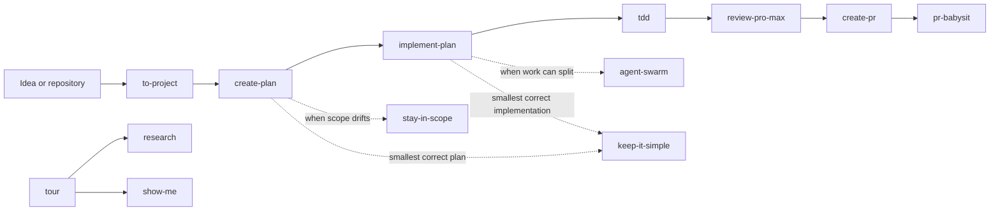

<div align="center">


# Srulik Toolkit

[](LICENSE)
[](https://claude.ai/code)
[](https://github.com/openai/codex)
[](https://github.com/tzachbon/srulik-toolkit/actions/workflows/validate.yml)

**Twenty focused skills for understanding, planning, and shipping software with Claude Code and Codex.**

[Install](#install) · [Choose a skill](#choose-a-skill) · [Contribute](CONTRIBUTING.md)

</div>

Srulik Toolkit packages the workflows I use to make sense of incoming requests, turn loose ideas into projects,
investigate questions, explain topics visually, give guided tours, write and implement plans, review changes, keep work in scope, delegate
suitable tasks, work test-first, and maintain pull requests. It also covers prose
editing, merge conflicts, CI failures, session recaps, and session retrospectives.

Each skill works on its own. Install one plugin, then invoke the skill you need
by name or describe the task in plain language.

## Install

### Claude Code

Run these commands in Claude Code:

```text
/plugin marketplace add tzachbon/srulik-toolkit
/plugin install srulik-toolkit@srulik-toolkit
```

Restart Claude Code after installation.

### Codex

```bash
codex plugin marketplace add tzachbon/srulik-toolkit --ref main
codex plugin add srulik-toolkit@srulik-toolkit
```

Start a new Codex task after installation. Open `/hooks` and trust the plugin
hook to enable the startup hint. Codex requires separate hook trust after an
installation or a hook change; installing the plugin alone does not grant it.

## Startup hint

On a new session, the plugin writes the twenty skill names and a short routing
instruction to model context. It uses the default `hooks/hooks.json` location
and runs only for `SessionStart` with the `startup` matcher. It does not run on
each prompt or skill invocation.

The same hook checks the installed version against this repository at most once
every 24 hours and suggests an upgrade only when the versions differ. The
request times out after two seconds; network and invalid-response failures are
silent and are not cached. It never upgrades automatically. Skills remain
available when the hook is disabled, untrusted, or offline.

## Blocked task recovery

When a main agent explicitly ends with a current blocked verdict, the `Stop`
hook gives it one more turn to inspect the failure and try an authorized route.
It stays silent for completed work, past blockers, subagents, and a second stop.
The hook does not grant access, bypass approvals, or turn planning into execution.
The agent may still report a real blocker after the recovery turn.

Recovery is on by default. Set `SRULIK_TOOLKIT_BLOCKED_STOP=0` in the agent's
environment before launch to disable only this hook. Codex users must review
and trust the new `Stop` hook through `/hooks` after updating the plugin.

## Choose a skill

| Skill | Use it when you want to |
| --- | --- |
| [`can-you-help`](plugins/srulik-toolkit/skills/can-you-help/SKILL.md) | Make sense of a supplied request, handle clear work, or decide together what help is needed. |
| [`to-project`](plugins/srulik-toolkit/skills/to-project/SKILL.md) | Turn an idea or an existing folder into a project with durable context. |
| [`create-plan`](plugins/srulik-toolkit/skills/create-plan/SKILL.md) | Research, draft, review, and revise an execution-ready plan until no actionable comments remain. |
| [`implement-plan`](plugins/srulik-toolkit/skills/implement-plan/SKILL.md) | Execute an approved plan, integrate and verify tasks, then repeat review and fixes until no actionable comments remain. |
| [`create-pr`](plugins/srulik-toolkit/skills/create-pr/SKILL.md) | Create a pull request with review evidence, merge danger, and blast radius. |
| [`execute-task-end-to-end`](plugins/srulik-toolkit/skills/execute-task-end-to-end/SKILL.md) | Explicitly request the full workflow: plan, issue, implementation, and a PR driven to `MERGE READY`, or verified `MERGED` when authorized, closing with a `recap`. |
| [`review-pro-max`](plugins/srulik-toolkit/skills/review-pro-max/SKILL.md) | Review a local diff, branch, or pull request without changing it. |
| [`stay-in-scope`](plugins/srulik-toolkit/skills/stay-in-scope/SKILL.md) | Re-establish the requested boundary when work starts to drift. |
| [`agent-swarm`](plugins/srulik-toolkit/skills/agent-swarm/SKILL.md) | Split independent work across available child agents and verify the result. |
| [`tdd`](plugins/srulik-toolkit/skills/tdd/SKILL.md) | Build one behavior at a time through red, green, and refactor. |
| [`keep-it-simple`](plugins/srulik-toolkit/skills/keep-it-simple/SKILL.md) | Find the smallest correct plan or implementation after understanding the affected flow. |
| [`research`](plugins/srulik-toolkit/skills/research/SKILL.md) | Investigate a question and produce a cited report with evidence gaps. |
| [`tour`](plugins/srulik-toolkit/skills/tour/SKILL.md) | Research a topic's history and current flow as a sourced visual narrative. |
| [`show-me`](plugins/srulik-toolkit/skills/show-me/SKILL.md) | Explain the current topic with concise diagrams and focused visual artifacts. |
| [`stop-slop`](plugins/srulik-toolkit/skills/stop-slop/SKILL.md) | Edit prose for direct language while preserving facts and uncertainty. |
| [`pr-babysit`](plugins/srulik-toolkit/skills/pr-babysit/SKILL.md) | Hand a pull request to a dedicated low-cost babysitter, preferably a subagent, that fixes conflicts, review feedback, and CI until closure, messaging you only when needed. |
| [`resolving-merge-conflicts`](plugins/srulik-toolkit/skills/resolving-merge-conflicts/SKILL.md) | Resolve conflicts by preserving the intended behavior of both sides. |
| [`fix-ci`](plugins/srulik-toolkit/skills/fix-ci/SKILL.md) | Diagnose failing checks, apply the smallest repair, and verify the result. |
| [`recap`](plugins/srulik-toolkit/skills/recap/SKILL.md) | Get a short, plain-language catch-up on a session: the whole thread around its goal, or focused on a topic you add. |
| [`retro`](plugins/srulik-toolkit/skills/retro/SKILL.md) | Learn from a coding session and propose evidence-backed improvements to the agent's environment. Adapted from Matt Pocock. |

Example prompts:

```text
$can-you-help Here is a Slack thread. Can you help?
$create-plan Add offline support to this app
$implement-plan Execute the approved plan in docs/offline-plan.md
$execute-task-end-to-end Add offline support and drive its PR to MERGE READY
$create-pr Open a pull request for the current changes
$review-pro-max Review the changes on my current branch
$tdd Implement expiration for cached sessions
$research Trace how this repository handles retries
$tour How did this repository's PR review workflow evolve?
$show-me Explain the current request flow
$fix-ci Diagnose and fix the failing checks on this pull request
$recap Catch me up on this thread from the beginning
$retro Review this session and suggest environment improvements
```

Claude Code may expose skills as slash commands. Codex uses `$skill-name`.
Plain-language requests can trigger a matching skill in either tool.
`execute-task-end-to-end` requires explicit invocation.

## How the toolkit fits together

Use only the skills that help with the current task. A common feature flow is:



`execute-task-end-to-end` makes PR creation and verified readiness its primary
Definition of Done. A plan, local changes, PR creation, or green CI alone is
intermediate progress. The main agent owns monitoring and fixes; a read-only
child filters event batches. Without merge authority, completion is `MERGE READY`
with current-head evidence and monitoring stopped. Explicit merge authority
requires verified `MERGED` and linked issue closure. Pending checks, missing
approvals and inaccessible evidence remain incomplete. This workflow overrides
`pr-babysit`'s default ownership and stop conditions; it creates no separate
top-level babysitter. Full end-to-end runtime behavior remains unverified.

`create-plan` checks installed skills first. For every non-trivial plan, it runs
one external search per material discipline even when an installed skill covers
the work. Loading a discovered skill is optional, and installation remains a
separate execution step that requires your approval.

It also verifies prior art for every plan, including trivial plans: check internal
precedents and run a focused external search, then inspect relevant sources. Start
briefly; a credible lead that could change the decision triggers deeper research.
Plans record findings, reuse decisions, research depth, stopping reasons, and
evidence gaps separately from skill discovery.

Plans make intended impact and blast radius explicit, classify consequential
steps as one-way or two-way doors with recovery limits, and include a “What can
go wrong” assessment with detection, prevention, stop conditions, and recovery
linked to execution tasks. Low-risk plans keep these assessments brief.

Redact or generalize confidential terms before external skill discovery. Never
send secrets, private paths, proprietary requirements, customer names, or
internal identifiers; if safe generalization is not possible, mark Skill
discovery: `INCOMPLETE`.

`implement-plan` consumes an approved engineering plan with task IDs, dependencies,
owned paths, and acceptance checks. It uses child agents and isolated worktrees
when supported and useful, or executes ready tasks serially when they are not.
Dependencies advance only after verified integration. Final acceptance and review
cover the integrated outcome; publication requires the user's authorization.
It creates no scheduler and installs no execution framework.

Both skills repeat review and fixes until the latest complete review of the current
plan or implementation reports zero actionable comments. Optional suggestions may
remain; they do not authorize scope expansion. Unresolved blockers and incomplete
reviews are reported explicitly and never count as a clean pass.
Each skill defaults to three review rounds; the user can set a different positive
whole-number cap. Failed attempts count, and fixes or resumes do not reset the
budget. At the cap without a clean verdict, stop, report incomplete with remaining
findings, and ask whether to continue. Until a complete review exists, each
attempt reviews the whole plan or change. Later rounds focus on changes since
the last complete review and unresolved findings while checking the full context
and wider effects; changes that invalidate prior coverage require another full
review.

Executor and reviewer selection uses script-provided scores for the actual
reasoning effort, task complexity and consequences, remaining usage, then cost.
There is no universal score cutoff; user model exclusions and task-specific score
floors still apply.

`create-pr`, `pr-babysit`, and `execute-task-end-to-end` rebase their own branch
onto the base and push it with `--force-with-lease`; they never force-push another
branch. `pr-babysit` triages old or inherited PRs (modernize, rework, or close)
before rebasing them, keeps contributor credit, labels comments it posts for you,
and declines review findings that would only grow the PR. `execute-task-end-to-end`
assumes nobody is watching: it proves each change with evidence from the session,
may run the app and browser checks without asking first, and asks blocking
questions through the host's question tool.

`create-pr` respects repository templates while explaining the changed behavior,
before/after evidence, whether recovery is a two-way or one-way door, and the
affected users, callers, or data. A small diagram is included when it helps review.

`to-project` now writes domain vocabulary to `GLOSSARY.md` in new projects.
Existing `CONTEXT.md` and `CONTEXT-MAP.md` remain supported. Capture and TDD
follow the project's selected vocabulary file; no existing project files are
renamed automatically. When both files exist, the glossary owns terms and context
retains background. `retro` continues to propose evidence-backed improvements
for human review; a retrospective alone does not authorize environment changes.

## Optional tools

- `review-pro-max` can use GitHub CLI for pull requests. It can also run
  CodeRabbit when you opt in and the command is installed and authenticated.
  CodeRabbit may send source outside the local machine.
- `agent-swarm` and `research` use available child-agent controls when useful.
  They can work inline when those controls are unavailable.
- `create-pr`, `pr-babysit`, and `fix-ci` can use an authenticated GitHub CLI
  or an equivalent connector for checks, logs, and pull requests. Local checks
  use the project toolchain.
- `pr-babysit` prefers a delegated subagent that owns a persistent native PR
  watch and keeps listening after its initial run and the parent turn end.
  When that is unavailable, it uses a separate babysitter conversation only
  with your explicit authorization. T3 Code currently requires this fallback
  because subagents cannot own PR watches. The skill lists the capabilities it needs; T3 Code's
  tool mapping is in
  [`plugins/srulik-toolkit/skills/pr-babysit/references/t3-code.md`](plugins/srulik-toolkit/skills/pr-babysit/references/t3-code.md),
  and other hosts
  map the same capabilities to their own tools after you confirm the mapping.
  That thread owns the watch, so PR events never wake the main conversation, and
  the main conversation sends requests to it only after its watch is active. Listening continues after green CI
  and quiet passes until the PR closes or you stop it. Hosts without that support
  report the limitation; the skill does not install a scheduler or substitute
  foreground waiting.
- `agent-swarm` and `pr-babysit` use
  `plugins/srulik-toolkit/scripts/models.js` for model facts from the public
  [Artificial Analysis](https://artificialanalysis.ai/evaluations/artificial-analysis-intelligence-index)
  dataset without an API key. Like `aa-models`, it lists effort variants, prices
  and benchmarks, filters by provider or model name, and caches for 24 hours
  with background refresh. `list` includes usage from the host's `aa-models usage`
  command when available; otherwise quota remains unknown. `--frontier` keeps
  existing price/intelligence comparisons working. The host's runnable-model
  catalog determines availability. If model data is unavailable, use a host
  benchmark tool or disclose the gap and use judgment.
- `to-project` can search public skill catalogs when you ask. It requires your
  approval before installing another skill.

## Optional companion plugin

[Smart Ralph](https://github.com/tzachbon/smart-ralph#installation) provides an end-to-end,
specification-driven workflow for persistent engineering work across multiple
sessions. Srulik Toolkit keeps its skills focused and independently invokable;
Smart Ralph remains a separately installed and versioned companion.

When a `create-plan` request is a strong fit, the skill offers a handoff once.
You choose whether to receive the official installation instructions or keep
planning with Srulik Toolkit. It never installs Smart Ralph automatically.

## Update or remove

### Claude Code

```text
/plugin marketplace update srulik-toolkit
/plugin update srulik-toolkit@srulik-toolkit

/plugin uninstall srulik-toolkit@srulik-toolkit
/plugin marketplace remove srulik-toolkit
```

### Codex

```bash
codex plugin marketplace upgrade srulik-toolkit

codex plugin remove srulik-toolkit@srulik-toolkit
codex plugin marketplace remove srulik-toolkit
```

Restart Claude Code or start a new Codex task after updating. In Codex, open
`/hooks` again and review trust if the hook changed.

## Windows

Use the same plugin commands in the shell supported by your Claude Code or
Codex installation. The startup checker and recovery hook use Node.js and have no other
runtime dependency.

Repository validation uses Bash and Python 3. On Windows, run it from Git Bash
with Python 3 on `PATH`. The CI matrix checks Linux, macOS, and Windows, including
the native Windows PowerShell and `cmd.exe` echo behavior. Project work may
require the tools used by that project.

## Local development

Clone the repository and run its checks:

```bash
git clone https://github.com/tzachbon/srulik-toolkit.git
cd srulik-toolkit
./scripts/validate.sh
```

Load the local Claude Code plugin with:

```bash
claude --plugin-dir ./plugins/srulik-toolkit
```

For Codex, register the checkout as a local marketplace:

```bash
codex plugin marketplace add .
codex plugin add srulik-toolkit@srulik-toolkit
```

The repository keeps the same skill payload for both tools:

```text
srulik-toolkit/
├── .agents/plugins/marketplace.json
├── .claude-plugin/marketplace.json
├── plugins/srulik-toolkit/
│   ├── .claude-plugin/plugin.json
│   ├── .codex-plugin/plugin.json
│   ├── hooks/hooks.json
│   └── skills/
└── scripts/validate.sh
```

Read [CONTRIBUTING.md](CONTRIBUTING.md) before opening a pull request. Use the
[issue tracker](https://github.com/tzachbon/srulik-toolkit/issues) for bugs,
skill ideas, and questions. Report security concerns through
[SECURITY.md](SECURITY.md).

## License and notices

Srulik Toolkit is available under the [MIT License](LICENSE). [NOTICE.md](NOTICE.md)
records source and optional-tool notices.
