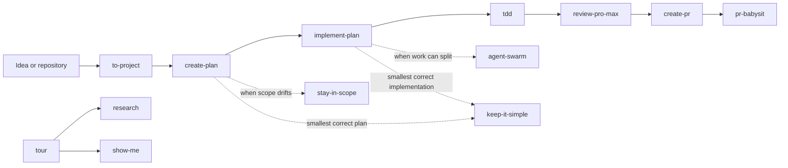

# How the toolkit fits together

Use only the skills that help with the current task. A common feature flow is:

`execute-task-end-to-end` makes PR creation and verified readiness its primary
Definition of Done. A plan, local changes, PR creation, or green CI alone is
intermediate progress. The main agent owns monitoring and fixes; a read-only
child filters event batches. Without merge authority, completion is `MERGE READY`
with current-head evidence and monitoring stopped. Explicit merge authority
requires verified `MERGED` and linked issue closure. Pending checks, missing
approvals and inaccessible evidence remain incomplete. This workflow uses
`pr-babysit`'s parent/subagent ownership and overrides its standalone stop
conditions; it creates no separate top-level babysitter. Full end-to-end runtime behavior remains unverified.

`create-plan` checks installed skills first. For every non-trivial plan, it runs
one external search per material discipline even when an installed skill covers
the work. Loading a discovered skill is optional, and installation remains a
separate execution step that requires your approval.

It also verifies prior art for every plan, including trivial plans: check internal
precedents and run a focused external search, then inspect relevant sources. Start
briefly; a credible lead that could change the decision triggers deeper research.
Plans record findings, reuse decisions, research depth, stopping reasons, and
evidence gaps separately from skill discovery.

Plans make intended impact and blast radius explicit, classify consequential
steps as one-way or two-way doors with recovery limits, and include a “What can
go wrong” assessment with detection, prevention, stop conditions, and recovery
linked to execution tasks. Low-risk plans keep these assessments brief.

Redact or generalize confidential terms before external skill discovery. Never
send secrets, private paths, proprietary requirements, customer names, or
internal identifiers; if safe generalization is not possible, mark Skill
discovery: `INCOMPLETE`.

`implement-plan` consumes an approved engineering plan with task IDs, dependencies,
owned paths, and acceptance checks. It uses child agents and isolated worktrees
when supported and useful, or executes ready tasks serially when they are not.
Dependencies advance only after verified integration. Final acceptance and review
cover the integrated outcome; publication requires the user's authorization.
It creates no scheduler and installs no execution framework.

Both skills repeat review and fixes until the latest complete review of the current
plan or implementation reports zero actionable comments. Optional suggestions may
remain; they do not authorize scope expansion. Unresolved blockers and incomplete
reviews are reported explicitly and never count as a clean pass.
Each skill defaults to three review rounds; the user can set a different positive
whole-number cap. Failed attempts count, and fixes or resumes do not reset the
budget. At the cap without a clean verdict, stop, report incomplete with remaining
findings, and ask whether to continue. Until a complete review exists, each
attempt reviews the whole plan or change. Later rounds focus on changes since
the last complete review and unresolved findings while checking the full context
and wider effects; changes that invalidate prior coverage require another full
review.

Executor and reviewer selection uses script-provided scores for the actual
reasoning effort, task complexity and consequences, remaining usage, then cost.
There is no universal score cutoff; user model exclusions and task-specific score
floors still apply.

`create-pr`, `pr-babysit`, and `execute-task-end-to-end` rebase their own branch
onto the base and push it with `--force-with-lease`; they never force-push another
branch. `pr-babysit` triages old or inherited PRs (modernize, rework, or close)
before rebasing them, keeps contributor credit, labels comments it posts for you,
and declines review findings that would only grow the PR. `execute-task-end-to-end`
assumes nobody is watching: it proves each change with evidence from the session,
may run the app and browser checks without asking first, and asks blocking
questions through the host's question tool.

`create-pr` respects repository templates while explaining the changed behavior,
before/after evidence, whether recovery is a two-way or one-way door, and the
affected users, callers, or data. A small diagram is included when it helps review.

`to-project` now writes domain vocabulary to `GLOSSARY.md` in new projects.
Existing `CONTEXT.md` and `CONTEXT-MAP.md` remain supported. Capture and TDD
follow the project's selected vocabulary file; no existing project files are
renamed automatically. When both files exist, the glossary owns terms and context
retains background. `retro` continues to propose evidence-backed improvements
for human review; a retrospective alone does not authorize environment changes.

`ui-ux-review` extracts review criteria from Next Level Builder’s UI UX Pro Max.
It maps every in-scope story and acceptance criterion to actual visual and
behavioral evidence, opens generated design images and implementation renders,
and checks reuse of the project's design system. It returns prioritized
findings with evidence, user impact, a small repair, and a verification step.
Missing visual or behavioral evidence makes coverage incomplete; passing code
checks cannot establish visual acceptance. Design-only reviews retain the
limits on unverified implementation behavior.
Design generation, search catalogs, and implementation tooling are not bundled.
