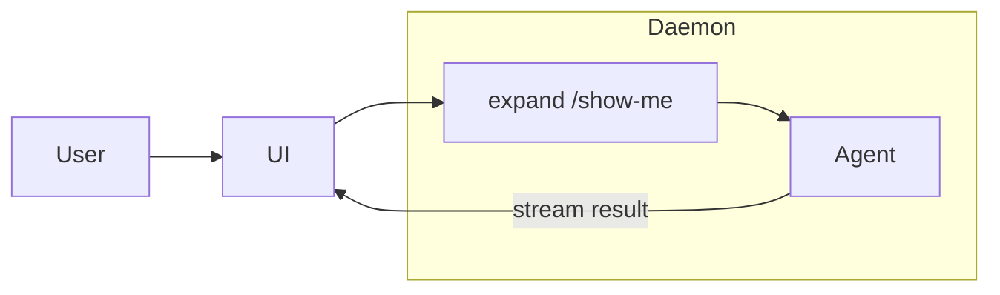
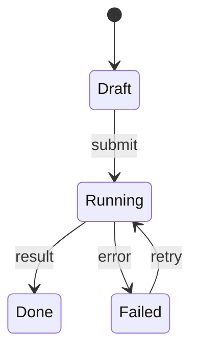
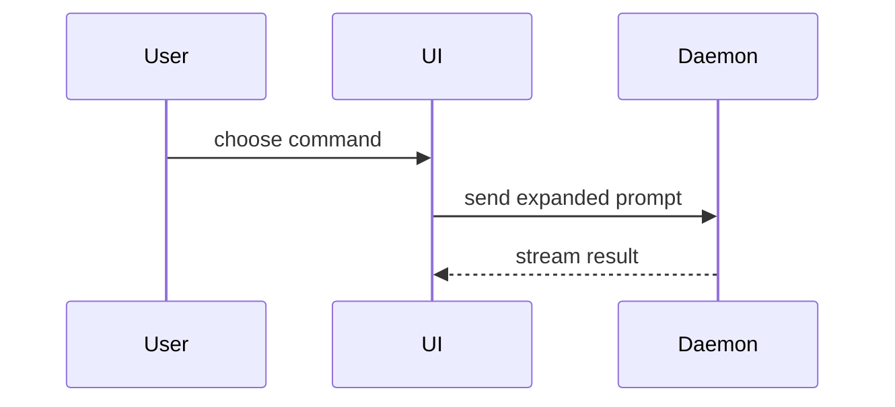
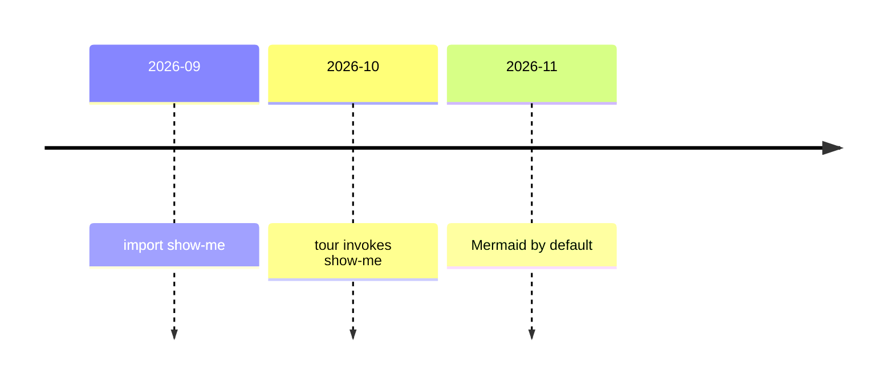
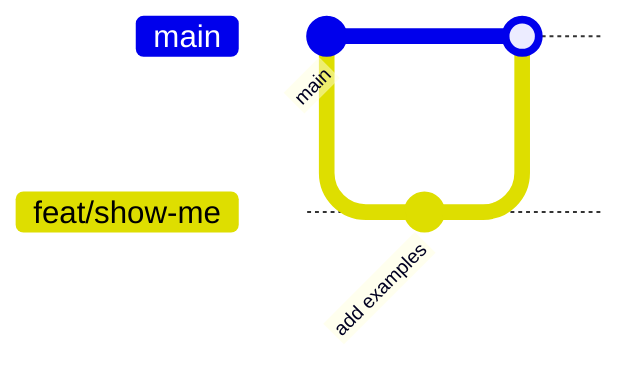
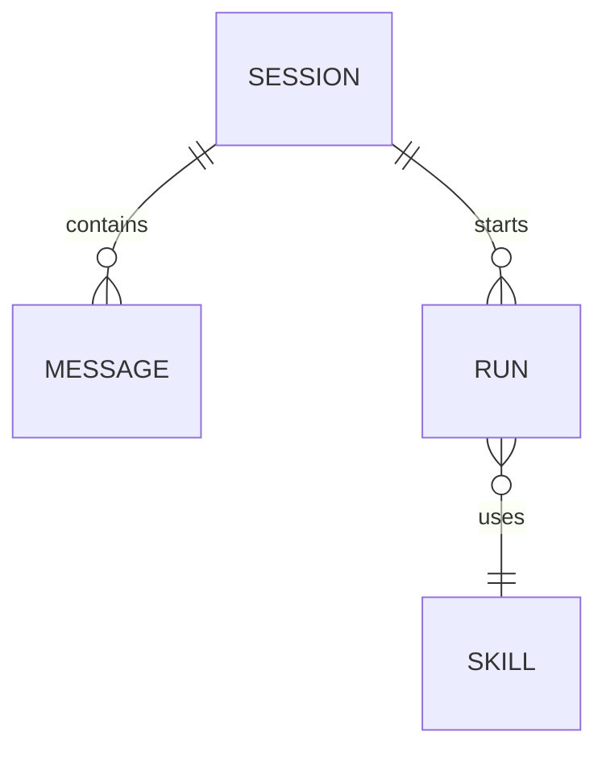

Help the user understand the current topic of conversation visually. Skip the preamble and keep prose brief. Pick the smallest view that makes the key point clear.

## Output by host capability

Choose the delivery format from the host's render capability for visuals shown in the chat reply:

- **Inline-HTML host** (a host that renders an HTML document inline in the thread): deliver every chat-reply visual — diagrams, recaps, code sketches, file trees, and diffs — as one focused, self-contained HTML page. Include Mermaid diagrams where relationships matter, clickable links for PRs, issues, or references, and collapsible `<details>` groups for secondary detail. See the [host mapping](references/t3-code.md) for a documented inline-HTML host; on an undocumented host, show your capability mapping, say it is untested, and use it only after the user confirms; until then, deliver the visual as a Mermaid-fence host would.
- **Mermaid-fence host** (a host that renders fenced `mermaid` blocks in Markdown): emit a `mermaid` block for relationships and fenced text trees, pseudocode, or diffs for code shape and changes.
- **Plain Markdown host** (no inline HTML and no Mermaid rendering): emit a `mermaid` block anyway for relationships — readable Mermaid source beats ASCII art — and fenced text trees, pseudocode, or diffs for code shape and changes.

**Chat vs. file scope:** interactive HTML applies only to visuals shown in the chat reply. Visuals written into files (plans, PR descriptions, documentation, or temporary Markdown reports) stay Markdown (`mermaid` blocks and fenced text trees, pseudocode, or diffs).

**No ASCII diagrams:** never draw flows, timelines, pipelines, or PR stacks with ASCII box-drawing or arrow art (`+---+`, `--->`, `<---`, `|---`, or Unicode box/arrow flowcharts such as `┌─┐` or `──▶`). Reserve text trees (`├──`, `└──`) strictly for file, component, or call-tree shape.

- Show logic or an algorithm as pseudocode:

```text
on(save)
  if content is unchanged
    return cached result
  write new content
  return fresh result
```

- Show which functions call which as a call tree:

```text
submitForm
  createSession
    persistPrompt
    launchAgent
  navigateToSession
```

- Show UI structure as a component tree, including state and module boundaries that matter:

```tsx
<SessionPage> (apps/example/src/routes/session.tsx)
  useSessionEvents()
  <SessionToolbar>
    <RunSkillButton> (packages/ui)
```

- Show file responsibility or a broad refactor as a shallow file tree:

```text
src/
├── commands/       # parses user actions
├── sessions/       # owns session state
└── transport/      # sends API requests
```

- Use Mermaid by default for relationships: branching control flow, data flow, component boundaries, state, interaction over time, chronology, branch history, and data models. Keep text trees, pseudocode, and diffs for code shape and changes. Keep each diagram to about 12 nodes, use real names from the topic, and quote labels that contain punctuation.

Show control flow, data flow, or component boundaries as a `flowchart`:



Show a lifecycle as a `stateDiagram-v2`:



Show interaction over time as a `sequenceDiagram`:



Show chronology as a `timeline`:



Show branch history as a `gitGraph`:



Show a data model as an `erDiagram`:



- Use `diff` when the point is what changes and the surrounding shape already exists. Match the diff shape to the topic.

For a component change:

```diff
 <SessionPage>
   useSessionEvents()
   <SessionToolbar>
+    <RunSkillButton />
   <SessionTimeline>
+    <SkillResultCard />
```

For a file-layout change:

```diff
 src/
 ├── commands/
+│   └── show-me.ts       # expands the slash command
 ├── sessions/
-└── transport.ts
+└── transport/
+    ├── client.ts
+    └── stream.ts
```

For a call-tree or call-stack change:

```diff
 submitForm
   createSession
     persistPrompt
+    expandSkillMention
     launchAgent
-  navigateToSession
+  navigateToSession
+    subscribeToEvents
```

For a state or control-flow change:

```diff
 on(save)
-  write content
+  if content is unchanged
+    return cached result
+  write new content
+  invalidate cache
```

- Show the whole block when most of it is new, when omitted context would hide ownership or order, or when the user needs a copyable target shape:

```ts
function expandSkill(command: string): string {
  const skillName = command.slice(1)
  return `use the ${skillName} skill`
}
```

- When delivering an HTML visual (every chat-reply visual on an inline-HTML host, or a visual UI, layout, state comparison, or concept too dense for Markdown on other hosts), build one focused, self-contained HTML page — a diagram, recap, code sketch, infographic, or short slide deck, whichever fits the point. Match the host's theme variables or product's colors, type, spacing, and components; use real labels and data; support desktop and mobile; use collapsible `<details>` groups when secondary detail would crowd the view. Context-encode untrusted text before inserting it, and keep scripts static and trusted. Render any diagram in it with Mermaid when remote resources are allowed: put the source in `<pre class="mermaid">`; place untrusted text (PR titles, commit messages, branch names, research text) only inside double-quoted Mermaid strings (`A["..."]`, `A -- "..." --> B`, `subgraph g1["..."]`, `participant p1 as "..."`, `commit id: "..."`), never in unquoted labels, `|...|` edge labels, or identifiers; use synthetic identifiers matching `[A-Za-z0-9_]+` for node, branch, subgraph, participant and section names; inside each such string, replace each line break with a space and write `<` `>` `"` `;` `#` `&` `%` as Mermaid entity codes `#lt;` `#gt;` `#quot;` `#59;` `#35;` `#38;` `#37;` in a single pass (a second pass would re-encode the `;` in the codes) (Mermaid decodes HTML entities such as `&lt;`, and `&quot` even without its semicolon, back into live characters, and a raw `"` or `;` can close the label and inject a `click` link); a raw `%%{init: ...}%%` would load remote CSS; write `click` directives, and `<a href>` links in a list or `<details>` block, only from `https://` URLs you built yourself, and drop any other scheme; and load the classic pinned SRI build followed by an explicit init script, both at the end of `<body>` after every `<pre class="mermaid">` (in `<head>`, `mermaid.run()` finds no diagrams and the raw source stays visible):

```html
<script src="https://cdn.jsdelivr.net/npm/mermaid@12.3.0/dist/mermaid.min.js" integrity="sha384-HHW54r639fK42Ip0coGF3mz8oSiGn0eEoWNTLs75X7H63pLSDBa0Tqs0RwGmLlXE" crossorigin="anonymous"></script>
<script>
  mermaid.initialize({
    startOnLoad: false,
    securityLevel: "antiscript",
    theme: window.matchMedia("(prefers-color-scheme: dark)").matches ? "dark" : "default",
  });
  // antiscript drops target="_blank"; reopen links outside the render frame.
  mermaid.run().then(() => document.querySelectorAll("svg a").forEach((a) => {
    a.setAttribute("target", "_blank");
    a.setAttribute("rel", "noopener noreferrer");
  }));
</script>
```

Mermaid `click` links (`click NodeId href "https://..." _blank`) work under `securityLevel: "antiscript"` in `flowchart` and `classDiagram` (`antiscript` strips `javascript:` links and blocks script callbacks); other diagram types, including `timeline`, `gitGraph` and `stateDiagram-v2`, do not reliably support `click`, so place clickable PR or issue links in a link list or collapsible `<details>` block beneath the diagram. When the caller or environment forbids remote resources, draw the diagram as inline SVG instead. Display the page through the host's inline HTML capability (see the [host mapping](references/t3-code.md)); otherwise write it to a collision-safe, OS-managed temporary path outside the repository and open the file for the user with the host's viewer or the OS opener; if neither is available, give its path.

### guidance

Place each visual next to the short text it supports. Keep only the calls, files, props, states, and boundaries needed to answer the user's current question or the options to resolve the current discussion point.

You may use one of these, you may use several, it is unlikely you will use all of them. Use your judgement and don't overwhelm the user.
