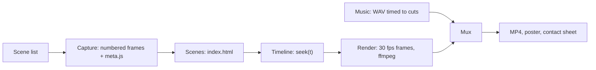

# Pipeline detail

Read this while building a video from the [starter template](../assets/template/README.md).
The steps match the core skill.

## 1. Story

Write the scene list first: scene id, job, duration, and the on-screen text. Use the
structure and lengths in [brand feel](brand-feel.md#pacing-and-structure). Keep a table of
every number on screen with its source (a file and line, a log entry with its timestamp,
a query and when it ran). Quoted chat or log text must be word for word from its source.
When a script builds that text, make it throw if a line is not found verbatim. Mark trims
on screen ("trimmed", "3 rows trimmed").

## 2. Capture

`capture-lib.mjs` opens headless Chromium at 1440x900 with a device scale factor of 2. It
draws an SVG cursor and a click ripple, because headless browsers draw no pointer. Mouse
moves follow an eased path, and screenshots loop as JPEG at quality 90, each with its
timestamp in `meta.js`. Call `mark('name')` at key moments; the edit keys cuts to these
names, so a new take stays in sync.

Make each `record-*.mjs` safe before it runs against a real app:

- Let only `GET`, `HEAD` and `OPTIONS` through. Abort every other request and log it.
  Request routing does not cover WebSockets; if the app writes over one, block it too or
  film against sample data.
- Answer event, analytics and telemetry posts locally with `204`, so the take adds no
  views or usage.
- Open confirmation dialogs, then cancel them. Never confirm a write.
- Blur people's names, emails and customer data with an init script before they render.
- Sign in beforehand and pass a saved storage state. Read keys from the environment or
  the OS secret store and never print them. Ask the user for access; never guess.

Prefer a test or staging environment with sample data. Report the blocked-request log
with the capture.

## 3. Scenes

`index.html` holds one absolutely positioned `<section class="scene" id="s-...">` per
scene on a 1920x1080 stage. Footage scenes hold an `` inside a
`.card`, and its `src` swaps to the frame for the current time.

## 4. Timeline

`timeline.js` turns time into state:

- `SCENES` lists durations, and start times are computed from them, so changing one
  scene shifts everything after it. A footage scene takes its duration from its clip.
- `window.DURATION`, `window.SCENES` and `window.ready` are read by the renderer.
- `window.seek(t)` sets the opacity, transform and text of every element in the active
  scene from its local time. Never use CSS transitions, animations or timers: the
  renderer does not wait for them.
- `appear` fades and rises, `draw` grows a rule, `clip` plays capture segments at chosen
  speeds (1x for a click, 4x for a page load) and holds the last frame, and `frameCard`
  with `camera` zooms into regions of the capture.

## 5. Stills while editing

`node render.mjs --stills 2,8` writes single frames to `out/stills/`. Check layout, copy
and timing on stills; render the full video only when they look right.

## 6. Render

`render.mjs` loads the page at 1920x1080, waits for `window.ready` and the fonts, then
seeks and screenshots every frame at 30 fps. ffmpeg encodes with `libx264`, CRF 16,
`yuv420p` and `+faststart`, so the file plays everywhere and streams. It also writes a
poster frame from the demo scene and prints each scene's start and end.

## 7. Music

`music.mjs` writes a WAV with plain Node math: no samples and no packages, so there is
nothing to license.

- Copy the scene starts that `render.mjs` prints into the `T` map at the top.
- Pick `BAR` so bar lines land on the cuts. For cuts at 4, 10 and 14 s a 2 s bar
  (120 BPM) works. For an uneven cut such as 38.9 s, use `BAR = 38.9 / 16`.
- One chord loop, ending on a held chord under the end card.
- Layers enter by section: pad alone under the title, then bass and arpeggio, then kick
  and hats, the full groove under the main demo, lighter after it.
- Accents on cuts: a riser before the main demo, a hit on its first frame, a soft swell
  under the stat.
- Mix: duck the pad and bass under each kick, add a Freeverb-style reverb, soft-clip with
  `tanh`, normalize the peak to about -1 dBFS.

Pass the rendered video's duration, so the track ends with the video.

## 8. Mux

Copy the video stream and encode the music as AAC at 192 kbit/s with `-shortest` and
`+faststart`. `build.sh` runs render, music, mux and the contact sheet in order.

## 9. Review

- Open `out/contact-sheet.png` (a frame every 5 s) to check pacing and find blank or
  broken frames in one view. A blank frame on a scene's first instant is its fade-in.
- Watch the full video once with sound.
- Check every number and quote on screen against its source table.
- Check the title card, the poster and the end card; people see these most.
- `ffprobe` must show `h264` and `aac` at 1920x1080 and the expected duration.

## Problems that come up

| Problem | Fix |
| --- | --- |
| A frame renders before the fonts load | Wait for `window.ready` and `document.fonts.ready` |
| Transitions show up half finished | Set every style from `seek(t)`; remove CSS transitions |
| The footage flickers | Skip setting `src` when the frame is unchanged, and await `img.decode()` |
| A new capture breaks the edit | Key clip cuts to named marks, not seconds |
| The music ends early or late | Pass the rendered duration to `music.mjs` and mux with `-shortest` |
| No pointer in headless capture | Draw the cursor with an init script |
| Music accents miss the cuts | Update the `T` map and `BAR` after any timing change |
