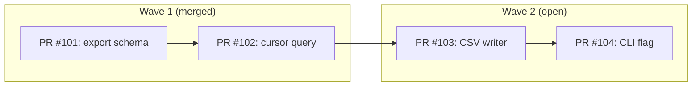

# Recap

**Goal:** Ship four stacked PRs across two waves for the billing export pipeline.



Changed modules:

```text
export/
├── schema.py      # PR #101
├── query.py       # PR #102
├── csv_writer.py  # PR #103
├── cli/
│   │
│   └── main.py    # PR #104
└── README.md
```

**Done:**
- Merged PR #101 (export schema) and PR #102 (cursor query) in wave 1.
- Opened PR #103 (CSV writer) and PR #104 (CLI flag) in wave 2.

**Now:** Waiting on CI for PR #104.
