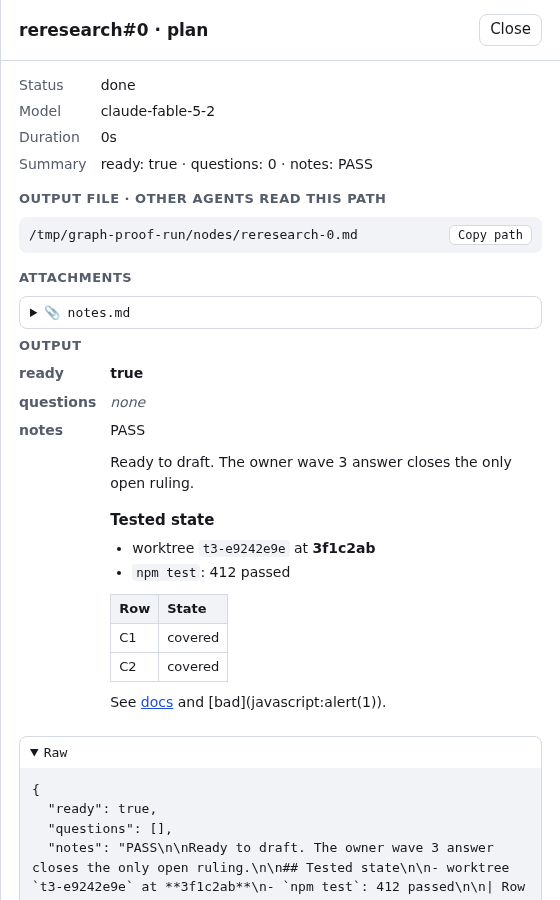
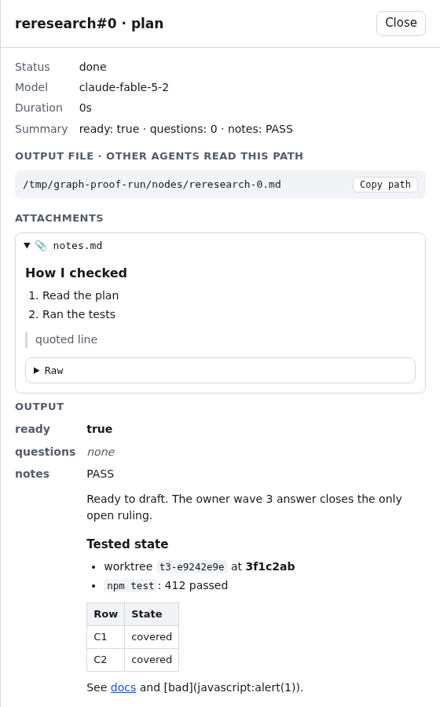
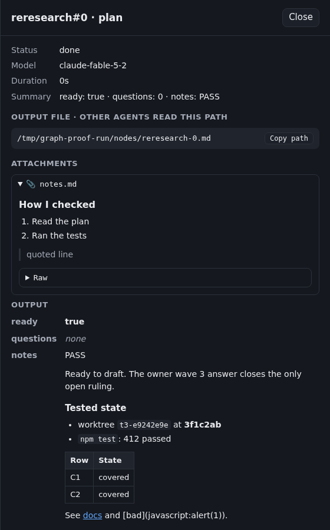
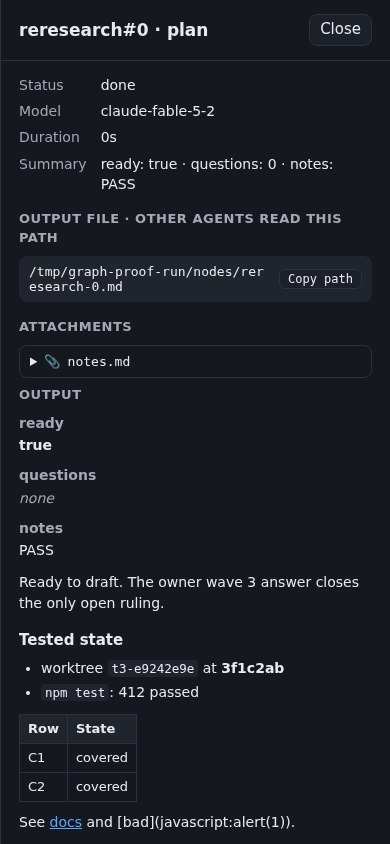
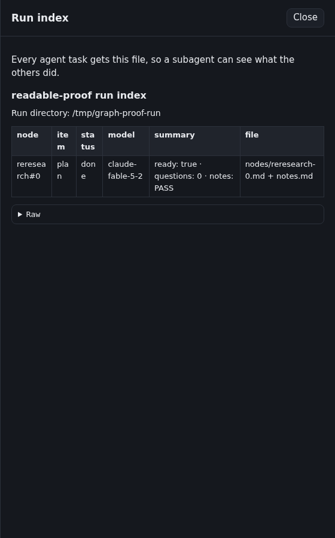

# Readable graph output: verification evidence

Plugin version: 1.27.0. Base: 064fb0f. Issue: #95.

## What was checked

- **Contract (C39, `scripts/test-graph-view.js`).** It runs `scripts/graph/render.js` in `vm` against a minimal DOM and compares the element tree:
  - JSON becomes labelled rows, and a multi-line string inside it renders as Markdown.
  - Markdown headings, tables and fences become text nodes.
  - Only `http(s)` links become anchors.
  - The served page inlines `render.js`.
- **Red proof.** Each of these makes C39 fail, and restoring the code passes:
  - widening the link pattern to accept `javascript:`
  - splitting table cells on escaped `\|` (review r4555798450)
  - rebuilding Raw from parsed JSON instead of the original text (review r4555798466)
  - closing a fence on any line that starts with three backticks (review r4555813914)
  - showing short JSON strings as plain text instead of inline Markdown (review r4555813921)
  - graph review round 1, bugs reviewer: `----` and `- - - -` not rendering as rules; a data row starting with `-` dropped as a table separator; a single-line ```` ```foo``` ```` opening a fence
  - graph review round 1, perf reviewer: the old regex inline parser took 2.1 s on 50,000 `[`, against a 250 ms bound in C39, and rendering a 5,000-entry list in full
  - graph review round 1, security reviewer: a heading of 40,000 `#` took 3.4 s through a quadratic trailing-`#` regex; 5,500 nested `>` quotes and 5,000-deep JSON overflowed the stack. Quotes now nest at most 20 levels and JSON at most 50, and Raw keeps the full text.
  - quadratic table-separator regex: a table row followed by 40,000 spaces took 1.1 s (review r4556014197). Separators are now checked cell by cell, and a sweep of every block and inline rule at 40,000-character inputs stays under 25 ms.
  - graph review round 2, security reviewer: the fence opener's `(?!.*`)` lookahead backtracked quadratically, taking 2.3 s on 50,000 backticks plus a later backtick. It is now a plain string check.
  - short JSON strings that start a Markdown block, such as `# Important`, now render as that block (CodeRabbit follow-up)
  - graph review round 2, perf reviewer: many `[` sharing one `]` re-ran the failing URL match for every bracket, taking 1.2 s on 1 MB. Each `]` now caches its URL result (25 ms). The reviewer's other finding was the fence-opener lookahead, already fixed.
- **Real browser.** I ran `graph-readable/browser-check.mjs` (exits 1 on any failed check) (Playwright, headless Chromium) against `node scripts/graph.js view` serving a fixture run. The fixture has one node: a JSON output whose `notes` holds Markdown, plus a `notes.md` attachment. All 14 checks passed:
  - rows and values
  - heading, list with code and bold, table
  - the http link, and the `javascript:` link left as text
  - Raw collapsed by default, and showing JSON when expanded
  - attachment Markdown
  - Run index table
  - dark theme contrast
  - no horizontal overflow at 390 px
  - no console errors
- `./scripts/validate.sh` passes.

## Screenshots

| | |
| --- | --- |
| Output and Raw, light |  |
| Attachment Markdown |  |
| Dark theme |  |
| Phone width (390 px) |  |
| Run index |  |

## Not covered

- A list or object shows its first 200 entries, then `… N more in Raw`. Raw always has the full text.

- Nested Markdown lists render flat.
- There is no syntax highlighting.
- I tested only Chromium.
