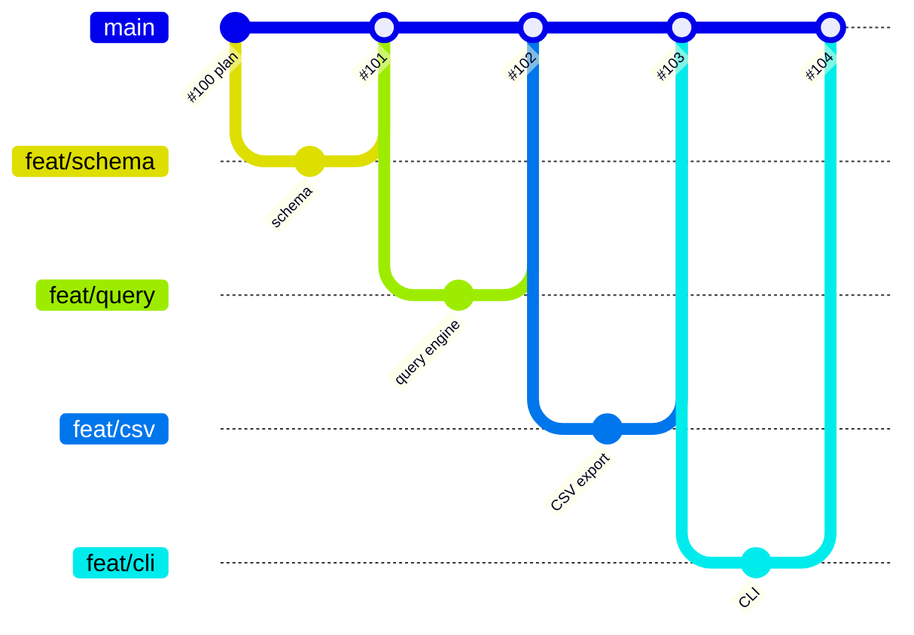

# Recap visual output evidence

`show-me`, `recap` and `tour` now pick the visual by what the host can render.
On an inline-HTML host, each chat visual becomes an HTML page that uses Mermaid,
clickable PR links and collapsible groups. Elsewhere it is a fenced `mermaid`
block. ASCII box and arrow art for flows, timelines, pipelines and PR stacks is
banned.

## Contract checks

`scripts/validate/23_visual_output.py` lints fenced blocks for ASCII and Unicode
diagram art. The parts `20_show_me.py`, `6_adopted_pr_lessons.py` and
`5_stop_hook_files.py` pin the new phrases. `1_setup_end_to_end.py` pins
`1.33.0` (originally 1.32.0; renumbered after `main` released 1.32.0).

Each check went red, in reverse part order, before the skill edits:

- Part 23 (then numbered 22), scratch copy with the fixture diagram removed:
  `scripts/fixtures/recap-ascii.md must trigger at least one ASCII/Unicode diagram violation`.
- Part 23 (then numbered 22), scratch copy with a `text` fence containing `A --> B` appended to
  recap: `banned ASCII/Unicode diagram in plugins/srulik-toolkit/skills/recap/SKILL.md:69: A --> B`.
- Part 20: `show-me is missing: ## Output by host capability`.
- Part 6: `recap skill missing contract: 'when an inline-HTML host renders the
  HTML page above the reply, open the reply text with **Goal**'`.
- Part 5: ``tour is missing contract phrase: Defer the chat visual format to
  `$show-me`'s host-capability routing``.
- Part 1: `wrong packaged VERSION`.

Mutation spot checks ran at the skill-edit head (`143a99f`), one change per
fresh copy, each exiting 1:

- `mermaid.esm.min.mjs` appended to show-me:
  `show-me must not use the broken ESM Mermaid build (mermaid.esm.min.mjs)`.
- `show-me/references/t3-code.md` deleted:
  `missing or external bundled resource 'references/t3-code.md': plugins/srulik-toolkit/skills/show-me/SKILL.md`.
- `## Observed live` removed from the reference:
  `show-me/references/t3-code.md is missing: ## Observed live`.
- `T3` appended to show-me, recap and tour in turn:
  `show-me core must stay host-neutral: T3`, `recap core must stay host-agnostic`,
  `tour core must stay host-neutral: T3`.
- The `gitGraph` line removed from recap:
  ``recap skill missing contract: 'Multi-PR stack or branch history: Mermaid `gitGraph`'``.
- The old sentence appended to tour:
  `tour still forbids the pinned SRI Mermaid build`.

Audit follow-up (`258c4c2`), one change per scratch copy, each exiting 1:

- One snippet's `securityLevel: "antiscript"` changed to `"loose"`:
  `show-me must set securityLevel: "antiscript" everywhere`.
- `host-capability output routing, ASCII-diagram ban,` deleted from NOTICE:
  `NOTICE.md is missing show-me attribution: host-capability output routing, ASCII-diagram ban,`.

Green: `./scripts/validate.sh`, `./scripts/check-version-bump.sh fe657b3`
(`Plugin version bumped: 1.32.0 -> 1.33.0 after merging `main`; originally 1.31.1 -> 1.32.0`) and `git diff --check fe657b3` pass.

## Live T3 Code render check

The planning probe on 2026-11-24 found that the ESM import
`mermaid.esm.min.mjs`, which show-me prescribed until now, never resolves in T3
Code's render frame, so readers saw raw Mermaid source. The classic
`mermaid@12.3.0/dist/mermaid.min.js` with SRI renders. A tampered hash is
blocked. `securityLevel: "antiscript"` strips `javascript:` click targets and
keeps `https` links.

The verification page followed the new show-me rules and
`show-me/references/t3-code.md`. It holds a `flowchart LR` of a plan and two
waves of two PRs each, four `click ... href` PR links, a `<details>` group per
wave, a transparent `html`/`body` and `:root` theme variables.

| Check | Result |
| --- | --- |
| `html_preview`, dark, 728 px | SVG rendered, console `svg:true links:4`, no errors, `contentHeight` 378 |
| `html_preview`, light, 728 px | SVG rendered in Mermaid's default theme, `svg:true links:4`, no errors, 378 |
| `html_preview`, dark, 390 px | Rendered and legible, 283 |
| `html_render`, height 378 | Shown inline in the thread above the reply |

## Live evaluation

Runtime: Claude Code 2.1.330, `claude -p` on `claude-opus-5-5`. Both runs used
`--strict-mcp-config`, `--no-session-persistence` and bypass permissions,
inside a fresh copy of the fixture. Provider credentials came from the parent
environment and were not written to disk. `with_skill` loaded this branch
through `--plugin-dir`. `old_skill` loaded a frozen `fe657b3` copy. One run per
side.

The fixture is a git repo for a small CSV tool. `TASKS.md` splits v0.2 into two
waves, and the history holds four `--no-ff` merges: #101 schema and #102 query
(wave 1), then #103 CSV export and #104 CLI (wave 2). It has no remote.

Prompt (both sides): `/srulik-toolkit:recap Recap this project's recent work
across the 4 merged PRs and 2 waves.`

E1-E4 were fixed before the runs:

- E1: a fenced `mermaid` `timeline`, `flowchart LR` or `gitGraph` shows the PRs.
- E2: the plan's standalone lint, which uses part 23's rules, reports 0 hits.
- E3: the recap keeps its shape: **Goal**, then the visual, **Done** with at
  most five items, **Now**, real PR numbers, nothing invented.
- E4: all four PRs appear in the right waves and order.

| Side | E1 | E2 | E3 | E4 | Time | Cost |
| --- | --- | --- | --- | --- | --- | --- |
| `with_skill` | pass (`gitGraph`) | pass (0 hits) | pass | pass | 30 s | $0.22 |
| `old_skill` | fail (ASCII in a bare fence) | fail (1 hit, line 6) | pass | pass | 35 s | $0.22 |

`with_skill` drew a `gitGraph` and put the PR links in a `<details>` block
below it, as the skill now says for diagram types without `click`. With no
remote configured, it said the links could not be built instead of inventing
URLs. `old_skill` drew the box-and-arrow art that started this change.

<details><summary>with_skill output</summary>

````markdown
This session has no earlier history, so the recap comes from the repo itself: `TASKS.md`, `git log` and the files. Checked just now.

**Goal:** Ship version 0.2 of `csvq`, a small tool for querying tables stored as CSV (plain comma-separated text), in two rounds of work called "waves".



<details><summary>PR links</summary>

I can't link these. The repo has no remote configured, and the merge commits only name `example/feat/*` branches, so I have no URLs for #100–#104.
</details>

**Done** (all merged into `main` on 2026-11-24 by author `dev`):
1. **#100:** wrote the plan in `TASKS.md`, splitting the work into two waves.
2. **Wave 1, the data layer (the part that stores and finds data):**
   - **#101** added `schema.py`, which defines what a table looks like and how to change that shape over time.
   - **#102** added `query.py`, the part that looks up rows in those tables.
3. **Wave 2, the parts a user touches:**
   - **#103** added `export.py`, which saves query results as a CSV file.
   - **#104** added `cli.py`, so you can run `csvq` from a terminal.

Think of it like building a library: Wave 1 builds the shelves and the catalog, and Wave 2 adds the checkout desk and the front door. The analogy breaks down at one point, covered next: the rooms are labelled but empty.

**Now:**
- **The code isn't written yet.** Each `.py` file is one line long and contains only its commit message, such as `feat: add query engine over the schema`. The merged PRs created placeholder files, not working code.
- **No release yet.** `TASKS.md` lists "release v0.2.0 tag (not done yet)", and `git tag` shows no tags. That is the next step on the board.
- The working tree is clean on `main`, and nothing else is in progress.

I couldn't check who decided the two-wave split or why; the repo doesn't record it beyond the plan commit.
````

</details>

<details><summary>old_skill output</summary>

````markdown
This session had no earlier history, so the recap comes from the repo: `TASKS.md`, `git log`, `git status`, and the files themselves.

**Goal:** Ship version 0.2 of `csvq`, a small tool for querying tables stored in CSV files. The plan split the work into two "waves" (rounds of work).

```
main ──●────────●─────────●─────────●─────────●──▶ (you are here, clean)
      #100     #101      #102      #103      #104
      plan     schema    query     CSV       CLI
               └── Wave 1: data ──┘└── Wave 2: user-facing ──┘
                                                  next: tag v0.2.0 (not done)
```

**Done**
- **#100, plan:** Wrote `TASKS.md`, which splits v0.2 into two waves. The log doesn't show who decided this; every commit is by `dev`.
- **#101, schema** (`schema.py`): Defines what tables look like, plus "migrations", which are steps for changing a table's layout later.
- **#102, query engine** (`query.py`): Asks questions of those tables. This finished Wave 1.
- **#103, CSV export** (`export.py`): Writes query results back out as CSV.
- **#104, command line** (`cli.py`): Lets you run `csvq` from a terminal. This finished Wave 2.

Wave 1 is like building the kitchen and Wave 2 like opening the serving window. The comparison breaks down here: none of the rooms are actually built yet (see below).

**Now**
- **The code files are empty.** Each `.py` file holds one line, which is a copy of its commit message (for example, `schema.py` contains `feat: add table schema and migrations`). The PRs are merged, but the features they describe don't exist yet as code.
- **v0.2.0 has not been released.** `TASKS.md` lists tagging v0.2.0 as the next step, and `git tag` shows no tags.
- `main` has no uncommitted changes and no remote, so I can't link to the PRs. Their numbers come only from the merge commit messages. The four branches (`feat/schema`, `feat/query`, `feat/csv`, `feat/cli`) still exist locally.

**Waiting on:** you. Before anyone tags v0.2.0, decide whether the one-line files are on purpose (for example, a stand-in or demo repo) or whether the real code still needs writing. Tagging now would release empty files.
````

</details>

### Chronology shapes

Two extra `with_skill` runs, same flags, prompt `/srulik-toolkit:recap Recap ...`:

| Fixture | Diagram chosen | lint hits | Time | Cost |
| --- | --- | --- | --- | --- |
| Exported single-thread conversation transcript (login timeout bug, 9 turns) | `timeline` | 0 | 23 s | $0.11 |
| Linear 5-commit repo, no PRs | `gitGraph` (allowed: branch history) | 0 | 31 s | $0.12 |

## Live T3 Code routing run

A fresh T3 Code child (`claude-sonnet-5-5`) read this branch's recap, show-me
and tour skills and did three tasks unprompted on routing:

| Task | Observed | Contract |
| --- | --- | --- |
| Recap the transcript | `html_preview` then `html_render` of a page with `flowchart LR` and `<details>`; 0 console errors; reply opens `**Goal:** ...` and carries no second diagram | inline-HTML routing, Goal placement |
| Write a plan file with a diagram | `plan.md` holds one ```` ```mermaid ```` fence, no HTML tags, 0 lint hits, no HTML tool called | chat vs. file scope |
| Short tour of `scripts/validate/run.py` | chat visual via `html_preview`/`html_render`; tour `.md` keeps a mermaid fence, 0 lint hits | tour defers to show-me, Markdown file |

Both rendered pages load only `mermaid@12.3.0/dist/mermaid.min.js` with the
pinned `sha384-HHW54r…` integrity and `securityLevel:"antiscript"`; no other
remote URL appears.

Re-audit probe (T3 `html_preview`, same build, `antiscript`): `click ... href`
produced an `<a>` in `classDiagram` and `flowchart`; `stateDiagram-v2` with
`click` failed to parse; `gantt` marked the task clickable but rendered no
link. show-me now limits the claim to `flowchart` and `classDiagram`.

Security-review probe (T3 `html_preview`, same build, `antiscript`): a label
written `raw &lt;img src=x&gt;` rendered a live `` (1 image in the SVG,
plus a blocked fetch of `x`). The same payload as `#lt;img ...#gt;`, and a
label-breakout payload written as `x#quot;]#59; click A href #quot;https://...#quot;`,
rendered as literal text with no image and no injected link. Only the trusted
`click B href "https://github.com/"` produced a link. show-me now requires
Mermaid entity codes for untrusted label text and trusted-only `click` URLs.

Bugs-review fixes (in-process red/green on part 23's function): reverting the
tree-prefix fix leaves `├── PR #101 ──▶ PR #102` unflagged (`tree prefix exempted
an arrow`); reverting the CommonMark info-string rule lets a line-start
```` ```mermaid``` ```` span hide a later ASCII block (`inline span opened a
fence`). Dropping show-me's end-of-`<body>` script placement fails part 20.

CodeRabbit probe (same build): a label holding raw `&quot]; click A href ...`
broke out of its label (the HTML parser decodes `&quot` without a semicolon), so
the diagram failed to parse. The same text with `&` written as `#38;` and `;`
as `#59;` rendered literally with no link. show-me now adds `&` to the single-pass
entity map, and the lint also checks `ascii` fences.

Review round 2 probes (same build, T3 `html_preview`):

- A label holding raw `%%{init: {'themeCSS': ... url(https://example.invalid/x)}}%%`
  restyled every node and fetched the URL. Written as `#37;#37;{init...}#37;#37;`,
  it rendered as literal text with no fetch. show-me now encodes `%` and
  replaces line breaks in untrusted labels.
- `antiscript` dropped `target="_blank"` from the `click` link (`target null`).
  show-me's snippet, extracted verbatim from SKILL.md, now sets
  `target=_blank rel=noopener noreferrer` after `mermaid.run()`, observed live.
- `click` and fallback `<a href>` links are limited to agent-built `https://` URLs.
- The lint now follows fences nested in a `markdown`/`md` fence: a nested
  `text` block with box art is flagged, and a nested `mermaid` block is not.

Review round 3 probe: an unquoted label `A[foo] ~~~ Z@{ img: https://... }]`
can open an image node (the reviewer saw a fetch; here the probe diagram failed
to parse). The same payloads inside double-quoted node and edge strings rendered
as literal text with 0 images. show-me now requires untrusted text only in
double-quoted strings and synthetic `[A-Za-z0-9_]+` identifiers everywhere else.

Durations come from each run's `duration_ms` in the `--output-format json` result.

SHA-256 at the evaluated head:

```text
7b87904c0849c9e9bb88b63653e95ceaf62901493f7c5059af37e58733c6358c  plugins/srulik-toolkit/skills/show-me/SKILL.md
ed336637ae3e07c1505c70852d4c7f56c49d051ec8dfc459eb0ea20320917b3d  plugins/srulik-toolkit/skills/recap/SKILL.md
3a4e46c1e1ba0f578db5f473bd776d964e38f950b24b587ed7fab41b63b3c946  plugins/srulik-toolkit/skills/tour/SKILL.md
9e17439c1acdbb6356db6e9a5bfe7c4fa1d002d3694a606992a06f9af03d2f1f  plugins/srulik-toolkit/skills/show-me/references/t3-code.md
```

After the evals, review fixes changed only show-me's HTML-page hardening
(`click` support list, Mermaid label encoding and quoting, script placement,
`target`/`rel` restore, https-only links, undocumented-host confirmation) and
the T3 reference's single-file preview rule. The routing, chat-vs-file and
recap `Show it` text the runs exercised is unchanged; the recap and tour skill
files are byte-identical to the evaluated head.

## Limits

- One synthetic fixture and one sample per side; this is a direction check,
  not a benchmark.
- The CLI renders Markdown only, so the paired eval covers the Markdown branch.
  The HTML branch was covered by one live T3 Code child run, not paired
  against the old skill.
- Inline-HTML hosts other than T3 Code are unverified.
- Human feedback: not collected before review; the owner reviews the PR.
- `tour` had one short live run, on a small read-only topic.
